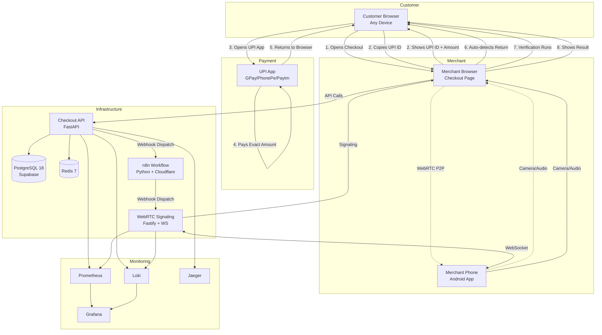
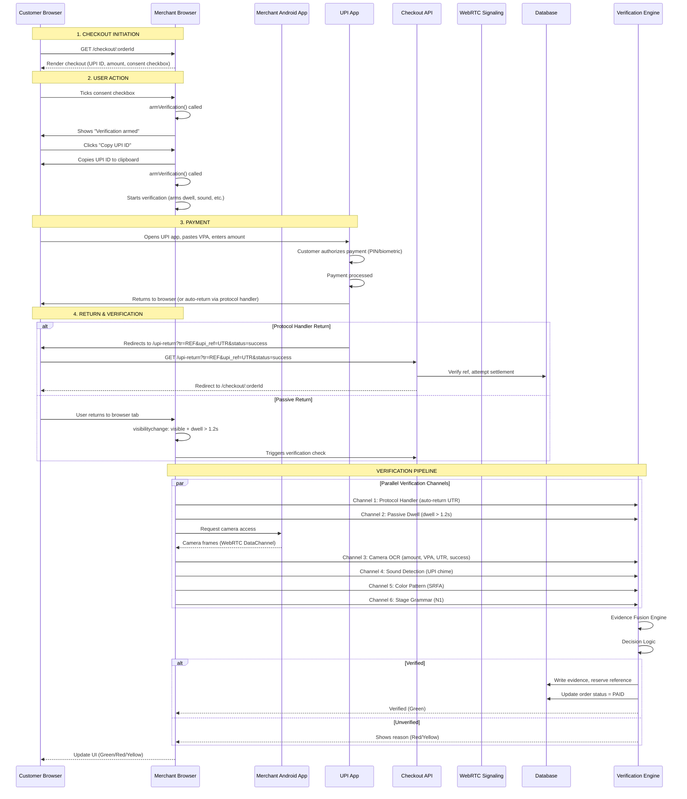
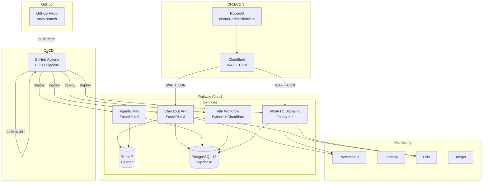
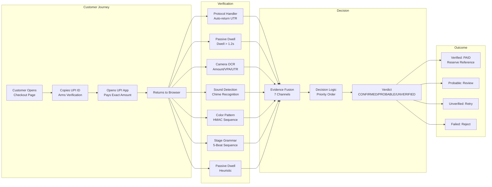
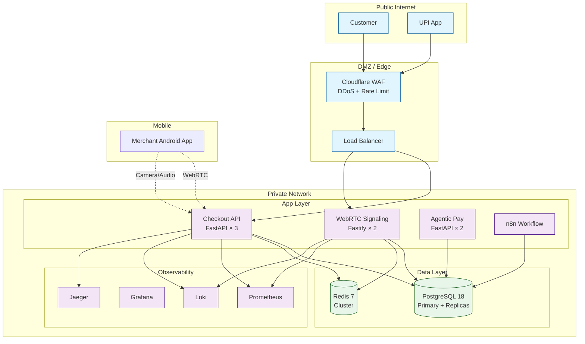
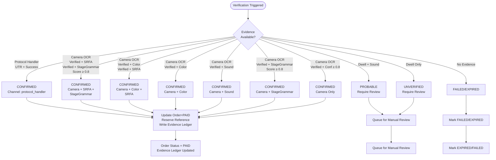
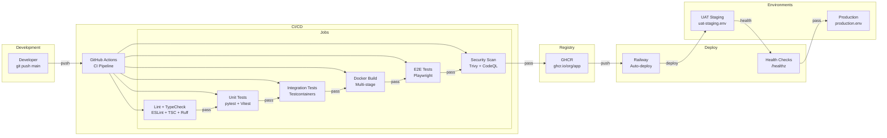
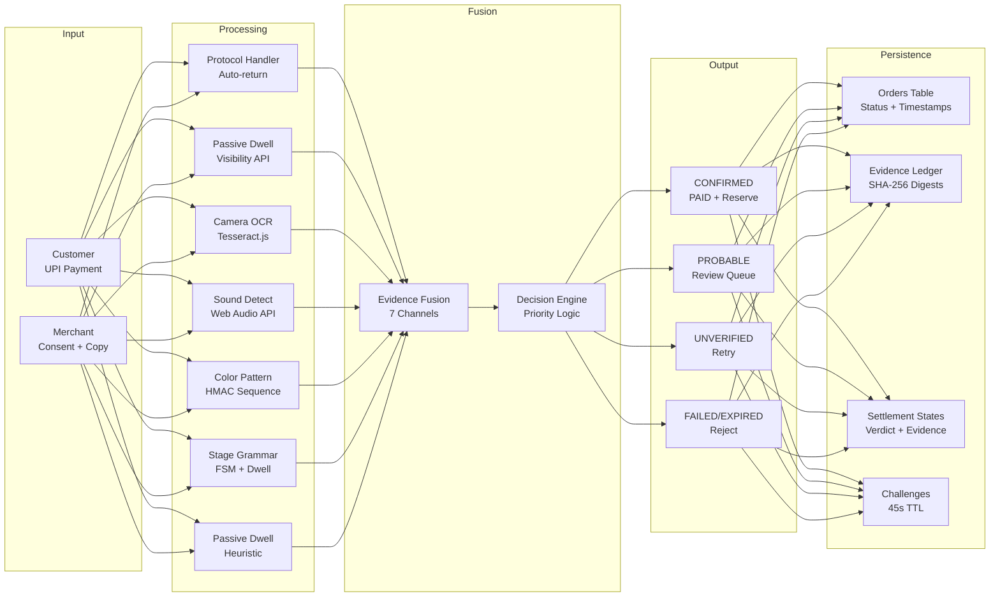

# Architecture Document

**Project:** UPI Checkout — Zero-Installation Payment Verification  
**Version:** 1.0  
**Status:** Production Ready

---

## 1. System Context



---

## 2. Payment Verification Flow



---

## 3. Verification Pipeline Detail

```mermaid
flowchart TD
    A[Verification Triggered] --> B{Protocol Handler<br/>Return URL?}
    
    B -->|Yes| B1[Extract UTR, Status<br/>Amount, VPA from URL]
    B -->|No| B2[Passive Dwell Detection<br/>visibilitychange + dwell > 1.2s]
    
    B1 --> C[Protocol Handler Channel<br/>Evidence: UTR, Status, Amount, VPA]
    B2 --> D[Passive Dwell Channel<br/>Evidence: Dwell Time, Quick Return]
    
    C --> E{Evidence Fusion}
    D --> E
    
    E --> F[Camera OCR Channel<br/>Amount, VPA, UTR, Success]
    E --> G[Sound Detection Channel<br/>UPI Chime Confidence]
    E --> H[Color Pattern (SRFA)<br/>HMAC Sequence Match]
    E --> I[Stage Grammar (N1)<br/>5-Beat Sequence Score]
    E --> F[Passive Dwell<br/>Dwell Time, Quick Return]
    
    F --> G{Evidence Fusion Engine}
    G --> H{Decision Logic}
    
    H -->|Protocol: Success + UTR| H1[CONFIRMED<br/>Channel: protocol_handler]
    H -->|Camera+SRFA+StageGrammar≥0.8| H2[CONFIRMED<br/>Camera+SRFA+StageGrammar]
    H -->|Camera+Color+SRFA| H3[CONFIRMED<br/>Camera+Color+SRFA]
    H -->|Camera+Color| H4[CONFIRMED<br/>Camera+Color]
    H -->|Camera+Sound| H5[CONFIRMED<br/>Camera+Sound]
    H -->|Camera+StageGrammar≥0.8| H6[CONFIRMED<br/>Camera+StageGrammar]
    H -->|Camera Only (conf≥0.8)| H7[CONFIRMED<br/>Camera Only]
    H -->|Dwell+Sound| H8[PROBABLE<br/>Require Review]
    H -->|Dwell Only| H9[UNVERIFIED<br/>Require Review]
    H -->|Default| H10[FAILED/EXPIRED]
    
    H1 --> I[Write Evidence<br/>Reserve Reference<br/>Order=PAID]
    H2 --> I
    H3 --> I
    H4 --> I
    H5 --> I
    H6 --> I
    H7 --> I
    H8 --> J[Mark PROBABLE<br/>Queue for Review]
    H9 --> K[Mark UNVERIFIED<br/>Queue for Review]
    H10 --> L[Mark FAILED/EXPIRED]
    
    I --> M[Update Order=PAID<br/>Reserve Reference<br/>Write Evidence Ledger]
    J --> M
    K --> M
    L --> M
```

---

## 4. WebRTC P2P Verification Flow

```mermaid
sequenceDiagram
    participant M as Merchant Browser
    participant S as Signaling Server
    participant P as Payer Browser
    participant MA as Merchant Android App
    
    Note over M,S,P: SETUP
    M->>S: register(merchant, ref)
    P->>S: register(payer, ref)
    
    M->>S: find_peer(ref)
    S-->>M: peerFound(payerId)
    
    M->>S: offer
    S->>P: offer
    P->>S: answer
    S->>M: answer
    
    M->>S: ice
    S->>P: ice
    P->>S: ice
    S->>M: ice
    
    Note over M,P: Data Channels Established
    par Data Channels
        M->>P: control (reliable)
        M->>P: verification (reliable)
        M->>P: camera (unreliable)
        M->>P: audio (unreliable)
    end
    
    Note over M,P: VERIFICATION FLOW
    M->>P: verification_request{ref, amount, vpa, transactionId}
    P->>M: verification_response{accepted: true}
    
    P->>P: Launch UPI App (upi://pay?...)
    P->>P: User pays in UPI app
    P->>M: payment_initiated{ref}
    
    par Verification
        P->>M: Camera frames (DataChannel: camera)
        P->>M: Audio chunks (DataChannel: audio)
        M->>M: OCR + Color + Stage Grammar + Sound
    end
    
    P->>M: payment_completed{ref, upiRef, status}
    M->>M: Verify with evidence
    M->>P: verification_result{verified: true}
    M->>M: Update order=PAID, reserve reference
```

---

## 3. Infrastructure Deployment



---

## 4. Data Flow



---

## 5. Security Boundaries



---

## 5. Verification Decision Tree



---

## 6. Deployment Pipeline



---

## 7. Data Flow Summary



---

## 8. Key Invariants

| Invariant | Enforcement |
|-----------|-------------|
| **120s Session Timeout** | Hard timeout in `UnifiedVerificationProtocol.start()` |
| **Paused Clock** | `visibilitychange` pauses timer during UPI app switch |
| **Challenge TTL** | 45 seconds, single-use, auto-cleanup |
| **Reference Dedup** | SHA-256(UTR) in `evidence_consumption` table |
| **No PII Capture** | Camera OCR filters PIN/OTP/balance/account# |
| **No PSP Dependency** | Zero external payment provider calls |
| **Auto-Termination** | All channels stopped on `finalize()` |
| **Consent Required** | Checkbox must be checked before arming |
| **Auto-Termination** | `stopAllChannels()` called on `finalize()` |
| **Consent Gate** | Checkbox `required` attribute, arms verification |

---

*End of Architecture Document*