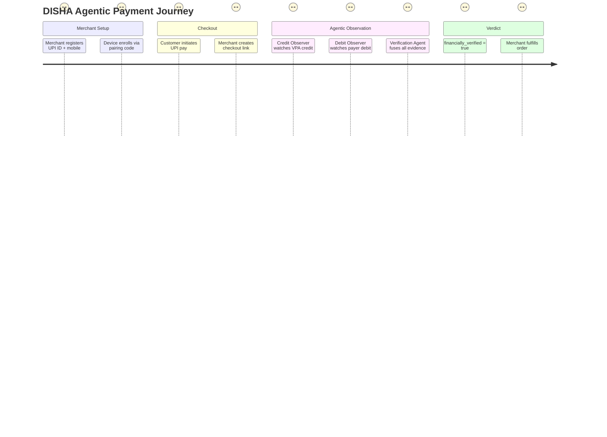
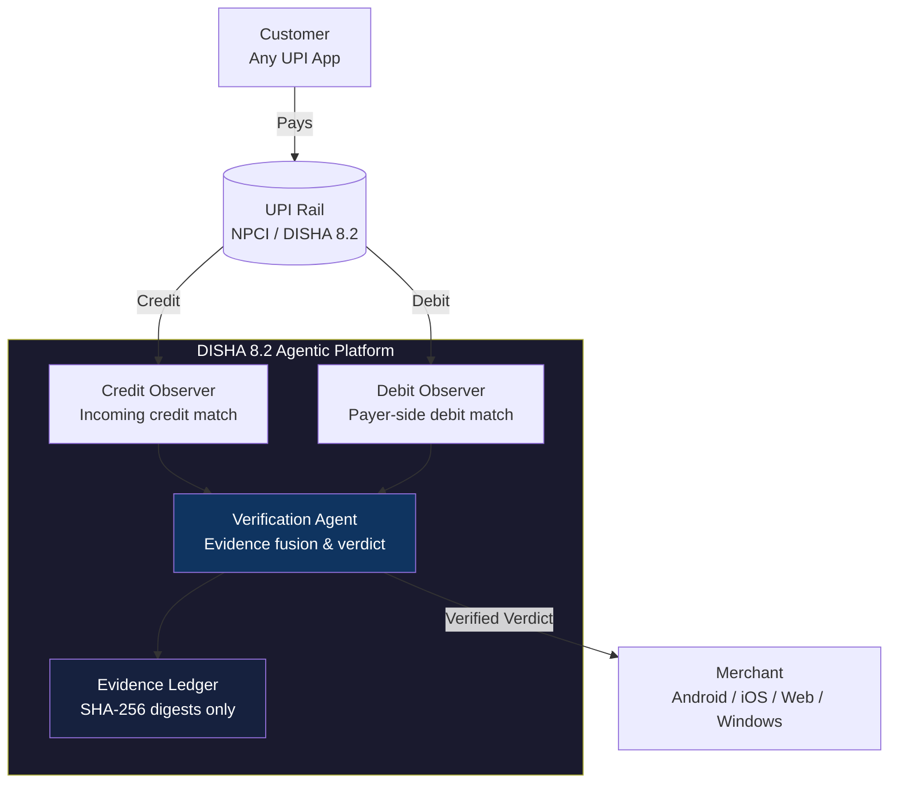
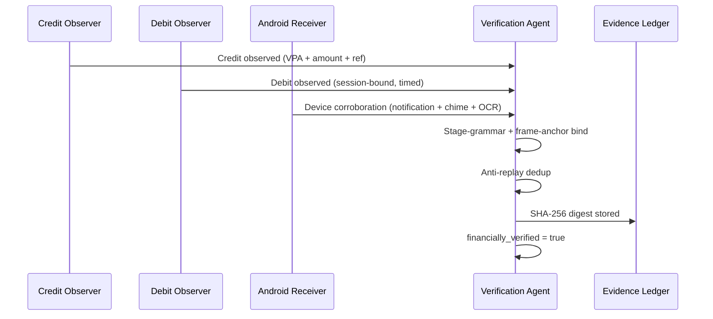

# DISHA — Agentic UPI Payment Verification Platform

**Autonomous agents that verify UPI payments in real time — zero PSP, zero money held, zero fraud.**

DISHA is not a payment gateway. It is an agentic verification layer: a swarm of autonomous agents (Credit Observer, Debit Observer, Verification Agent, and Android Receiver Agent) that watch, correlate, and certify that a UPI debit actually completed — before the merchant fulfills the order.

Treat the payer device as hostile. No screenshot, UTR entry, browser resume, or synthetic local signing may set `financially_verified = true`. DISHA never holds customer money. Funds move directly between payer and payee on the UPI rail. DISHA only observes and certifies.

---

## The Agentic Workforce

DISHA runs four autonomous agents. Each has a single duty. Together they form an evidence chain no single channel can fake.

### Credit Observer — "Did the money arrive?"
Watches the merchant's registered VPA for incoming UPI credits. Confirms the payee VPA, amount, and transaction reference match the live checkout session. Emits a `CREDIT_OBSERVED` event only when all three match server-side — never from client-submitted proof.

### Debit Observer — "Did the payer actually pay?"
Watches the payer-side confirmation flow. Validates that a debit was initiated on the payer's UPI app, correlates it to a live checkout session, and binds it to a 120-second time-bound window. Rejects any debit claim lacking cross-channel corroboration.

### Verification Agent — "Is the evidence complete?"
Fuses evidence from Credit Observer, Debit Observer, and the Android Receiver Agent. Applies stage-grammar sequencing, frame-anchor cryptographic binding, and anti-replay deduplication. Sets `financially_verified = true` only when the full evidence chain is intact — never from a single channel, never from a screenshot.

### Android Receiver Agent — "The merchant's eyes and ears"
A native Android companion that runs on the merchant device. Observes UPI notifications, camera frames (OCR), and audio success-chimes. Runs under `FLAG_SECURE` (screenshot prevention), root detection, and encrypted credential storage (EncryptedSharedPreferences + AndroidKeyStore). Enrolls per-merchant via secure pairing code. Each agent mobile registers its own UPI ID and mobile number as the receiving account.

---

## Why DISHA Is Zero Fraud

| Fraud Vector | Traditional Checkout | DISHA Agentic Platform |
|--------------|---------------------|------------------------|
| Forged screenshot | Accepted as proof | Rejected — payer device treated as hostile |
| Manual UTR entry | Error-prone, fakeable | Zero manual entry — agents observe directly |
| Browser resume after payment | Blind spot | Stage-grammar + frame-anchor binding |
| Single-channel spoofing | Possible | Multi-agent fusion required |
| Funds held by platform | Common | Never — DISHA touches no money |
| Replay attack | Works | Frame-anchor + SHA-256 dedup kills it |

**`financially_verified = false` by default.** It flips to `true` only when all agents agree the debit is real, time-correlated, and amount-matched.

---

## End-to-End Flow: Customer Pays, Merchant Fulfills



### Step-by-Step

1. **Merchant registers** their UPI ID and mobile number as a receiving account.
2. **Merchant device enrolls** with DISHA via encrypted pairing code — unique device ID, AES-256 encrypted credentials.
3. **Customer initiates checkout** — merchant creates a payment link with a 120-second verification window.
4. **Customer pays** via any UPI app (GPay, PhonePe, Paytm, BHIM, etc.).
5. **Credit Observer** detects the incoming credit to the merchant VPA.
6. **Debit Observer** detects the payer-side debit and binds it to the session.
7. **Verification Agent** fuses evidence across protocol handler, camera OCR, sound chime, color-pattern HMAC, stage grammar, and passive dwell.
8. **Verdict issued** — `financially_verified = true` only when all agents agree.
9. **Merchant fulfills** — instant, zero chargeback risk, no PSP webhook wait.

---

## Architecture: Four Agents, One Evidence Chain



### Evidence Fusion (inside the Verification Agent)



---

## Self-Hosted: How It Works

DISHA is designed to be self-hosted on Railway (or any Docker host). Two services run independently:

| Service | Role | Dockerfile |
|---------|------|------------|
| `checkout-api` | Public checkout + verification API | `Dockerfile` |
| `agentic-pay` | Merchant dashboard + agentic backend | `Dockerfile.agentic` |

Each merchant gets their own virtual Android device (or web/iOS/Windows client) configured in their merchant tent. The agent mobile collects up to ₹70,000 daily per shop, then closes — no money ever touches DISHA.

### Deploy to Railway

```bash
railway login
railway link
railway up
```

**Required environment variables** (set in Railway dashboard):
- `DATABASE_URL` — Checkout PostgreSQL connection string
- `AGENTIC_DATABASE_URL` — Agentic Pay PostgreSQL connection string
- `AGENTIC_OWNER_TOKEN` — Secure random secret (43–128 chars)
- `AGENTIC_ACCOUNT_KEY` — Fernet encryption key
- `PORT` — Set automatically by Railway

### Health check

```bash
curl https://<service>.up.railway.app/healthz
# {"ok": true, "verification": "PENDING"}
```

---

## Platform Support

| Platform | Status | What Runs |
|----------|--------|-----------|
| **Android** | Live | Native receiver app with notification listener, camera OCR, audio chime detection |
| **iOS** | Upcoming | Safari protocol handler, Shortcuts integration |
| **Web** | Live | Browser-native verification, zero install |
| **Windows** | Upcoming | Native UPI deep-link handling |

**Bank participation licensing is in progress.** DISHA is architected as a verification observability layer — it does not hold, move, or settle customer funds — so it operates without a bank partnership today.

---

## Compliance & Trust

- **No money held** — DISHA never escrows, settles, or touches customer funds
- **No PSP required** — works with any UPI app, no bank integration needed
- **No sensitive data captured** — no PIN, OTP, balance, or full account numbers
- **SHA-256 digest only** — evidence ledger stores hashes, never raw UTRs or VPAs
- **120-second hard timeout** — sessions auto-expire; clock pauses during UPI app switch
- **Hostile device model** — no client-submitted proof alone sets verification
- **Financially verified stays false** until the full agent evidence chain is intact

---

## Project Structure

```
checkout/
├── server.py              # Public checkout + verification API
├── agentic_app.py         # Agentic Pay merchant platform entry point
├── agentic_api.py         # Agentic Pay REST API (daily limit, UPI register, email notify)
├── agentic_storage.py     # Isolated Agentic Pay database schema (merchants, accounts, orders, devices)
├── saas.py                # Super Admin control center + per-tab health verification
├── static/                # Admin dashboard, merchant portal, checkout UI
├── agentic_assets/        # Agentic Pay frontend assets
└── Dockerfile             # Checkout API container
recovery-agent/
├── android/               # Native Android receiver app (Kotlin)
│   ├── MainActivity.kt            # Dashboard, daily ₹70,000 limit, device enrollment
│   ├── RegisterUpiActivity.kt     # UPI ID + mobile number registration
│   ├── CheckoutActivity.kt        # 120s checkout creation + auto-poll verification
│   ├── UpiPaymentObserver.kt      # Notification listener + credit observation
│   ├── HeartbeatWorker.kt         # Device heartbeat + online status
│   ├── DeviceConfig.kt            # Encrypted device config + daily limit enforcement
│   ├── RootUtil.kt                # Root detection security
│   └── ci-startup.sh              # CI emulator validation script
├── recovery/              # Recovery backend API
└── tests/                 # Integration test suites (214 passing)
.github/
└── workflows/             # CI: Checkout verification, Agentic Pay, Android APK build
railway.toml               # Railway service definitions
LICENSE                    # Proprietary Commercial License (PCL-1.0)
```

---

## Roadmap

| Version | Focus |
|---------|-------|
| **DISHA 8.2** (Current) | Four-agent verification, Android receiver, daily collection limit, Railway deploy |
| **DISHA 9.0** | iOS + Windows clients, bank participation licensing |
| **DISHA 10.0** | Multi-merchant federation, webhook exports, PSA-level audit |

---

## License

DISHA is protected under a **Proprietary Commercial License (PCL-1.0)**.

- All rights reserved. The software is licensed, not sold.
- May not be used as a payment gateway, wallet, escrow, or any system that holds customer funds.
- Bank participation requires a separate written commercial agreement.
- Unauthorized redistribution, reverse engineering, or third-party deployment is prohibited.

See `LICENSE` for full terms.

---

## Support

- **Issues:** [github.com/Tashima-Tarsh/checkout/issues](https://github.com/Tashima-Tarsh/checkout/issues)
- **Discussions:** [github.com/Tashima-Tarsh/checkout/discussions](https://github.com/Tashima-Tarsh/checkout/discussions)
- **Security:** Report vulnerabilities privately via GitHub Security Advisories

---

*DISHA — Agentic verification that moves at the speed of UPI. Four agents. One verdict. Zero fraud. Zero money held.*
