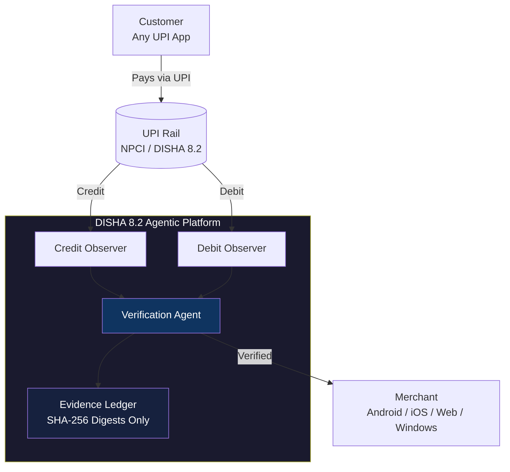
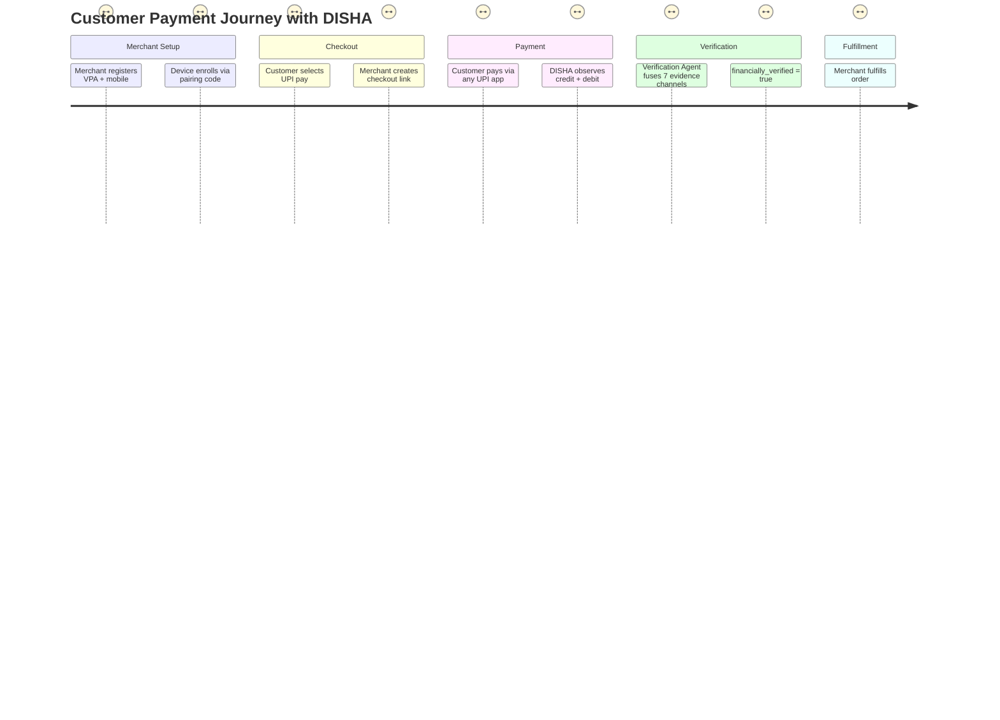

# DISHA — Agentic UPI Payment Verification Platform

**Instant UPI debit verification with zero PSP dependency, zero app installation, and zero fraud exposure.**  
Built for merchants who want to fulfill orders the moment payment completes — without waiting for webhooks, screenshots, or manual UTR entry.

---

## What DISHA Is

DISHA is an agentic payment verification layer for UPI (Unified Payments Interface). It treats the payer device as hostile and never accepts screenshots, UTR entry, browser resume, or local signing as proof of debit. Instead, it fuses multiple independent evidence channels — protocol handler, camera OCR, sound detection, color-pattern HMAC, stage-grammar sequencing, and passive dwell analysis — to confirm a payment actually completed before the merchant fulfills the order.

**DISHA does not hold customer money.** It is a verification observability platform, not a payment gateway, wallet, or escrow service. Funds move directly between payer and payee through the UPI rail. DISHA only observes and certifies that the debit event occurred.

---

## Product Position

| Capability | DISHA | Traditional Checkout |
|------------|-------|---------------------|
| PSP dependency | None | Required |
| App installation | None | Required |
| Screenshot / UTR as proof | Rejected | Accepted |
| Money held by platform | Never | Often |
| Instant fulfillment | Yes | 3–5 day settlement |
| Platforms | Android, iOS, Web, Windows | App-bound |
| Bank participation | Licensing in progress | Direct integration |

---

## Core Agents

DISHA runs a swarm of lightweight, purpose-built agents that observe, verify, and certify payment events without ever touching funds.

### Credit Observer
Watches for incoming UPI credits against a merchant's registered VPA. Confirms the amount, payee VPA, and transaction reference match the expected checkout. Emits a credit-observed event only when all three match server-side.

### Debit Observer
Watches the payer-side confirmation flow. Validates that a debit was initiated on the payer's UPI app, correlates it to a live checkout session, and binds it to a 120-second time-bound window. Rejects any debit claim that lacks cross-channel corroboration.

### Verification Agent
Fuses evidence from all observers and channels. Applies stage-grammar sequencing, frame-anchor cryptographic binding, and anti-replay dedup. Sets `financially_verified = true` only when the full evidence chain is intact — never from a single channel.

### Android Receiver Agent
A native Android companion that observes UPI notifications, camera frames, and audio chimes on the merchant device. Runs with `FLAG_SECURE` (screenshot prevention), root detection, and encrypted credential storage. Enrolls per-merchant via pairing code.

---

## Architecture



### Evidence Fusion Chain

```mermaid
sequenceDiagram
    participant C as Customer
    participant M as Merchant App
    participant VA as Verification Agent
    participant CO as Credit Observer
    participant DO as Debit Observer
    participant EL as Evidence Ledger
    
    C->>M: Initiate checkout (₹ amount)
    M->>VA: Create 120s verification session
    C->>UPI: Pay via any UPI app
    UPI->>CO: Credit notification
    UPI->>DO: Debit confirmation
    CO->>VA: Credit observed (VPA + amount + ref match)
    DO->>VA: Debit observed (session-bound, time-correlated)
    VA->>VA: Fuse evidence &lt;7 channels&gt;
    VA->>EL: SHA-256 digest stored
    VA->>M: financially_verified = true
    M->>C: Order fulfilled instantly
```

### Security Boundaries

```mermaid
graph LR
    subgraph Payer["Payer Device (Hostile)"]
    end
    
    subgraph Merchant["Merchant Device"]
        A[Android Receiver<br/>FLAG_SECURE + Root Detection]
        W[Web / iOS / Windows Client]
    end
    
    subgraph DISHA["DISHA Cloud Platform"]
        VA[Verification Agent]
        CO[Credit Observer]
        DO[Debit Observer]
        EL[Evidence Ledger]
    end
    
    Payer -.->|UPI Intent| Merchant
    Merchant -->|Encrypted| DISHA
    DISHA -->|Verified Verdict| Merchant
    
    style Payer fill:#2d1b1b
    style Merchant fill:#1b2d2d
    style DISHA fill:#1a1a2e
```



---

## End-to-End Flow



### Step-by-Step

1. **Merchant registers** their UPI ID and mobile number as a receiving account.
2. **Merchant device enrolls** with DISHA via a secure pairing code (encrypted credentials, unique device ID).
3. **Customer initiates checkout** — merchant creates a payment link with a 120-second verification window.
4. **Customer pays** via any UPI app (GPay, PhonePe, Paytm, BHIM, etc.).
5. **DISHA agents observe** the credit and debit events across multiple independent channels.
6. **Verification Agent fuses evidence** — protocol handler, camera OCR, sound chime, color-pattern HMAC, stage grammar, passive dwell.
7. **Verdict issued** — `financially_verified = true` only when the full chain is intact.
8. **Merchant fulfills** — instant, zero chargeback risk, no PSP webhook wait.

---

## Why DISHA Is Different

| Traditional UPI Checkout | DISHA Agentic Platform |
|--------------------------|------------------------|
| Merchant waits for SMS/email | Instant agentic verification |
| Screenshots accepted as proof | Screenshots rejected — hostile device model |
| Manual UTR entry | Zero manual entry |
| PSP webhook dependency | Zero PSP dependency |
| 3–5 day settlement wait | Fulfill on verified debit |
| Funds held by platform | Never holds funds |
| Single-point fraud risk | Multi-channel evidence fusion |
| App-bound | Android, iOS, Web, Windows |

---

## Platform Support

| Platform | Status | Notes |
|----------|--------|-------|
| **Android** | Live | Native receiver app, notification listener, encrypted storage |
| **iOS** | Upcoming | Safari protocol handler, Shortcuts integration |
| **Windows** | Upcoming | Electron wrapper, native UPI deep-link handling |
| **Web** | Live | Browser-native, zero-install verification |

**Bank participation licensing is in progress.** DISHA is architected as a verification observability layer, not a payment system, so it operates without holding, moving, or touching customer funds.

---

## Compliance & Trust Model

- **No money held** — DISHA never touches, escrows, or settles funds
- **No PSP required** — works with any UPI app, no bank integration
- **No sensitive data captured** — no PIN, OTP, balance, or full account numbers
- **SHA-256 digest only** — evidence ledger stores hashes, never raw UTRs or VPAs
- **120-second hard timeout** — sessions auto-expire; clock pauses during UPI app switch
- **Treat payer device as hostile** — no client-submitted proof alone sets verification
- **Financially verified stays false** until full evidence chain is intact

---

## Quick Deploy (Railway)

DISHA is production-configured for Railway with zero-config Docker deployment.

```bash
# 1. Login to Railway
railway login

# 2. Link this repository
railway link

# 3. Deploy both services
railway up
```

**Services deployed:**
- `checkout-api` — Public checkout + verification API (`Dockerfile`)
- `agentic-pay` — Agentic Pay merchant dashboard + observer backend (`Dockerfile.agentic`)

**Health check:**
```bash
curl https://your-app.up.railway.app/healthz
# {"ok":true,"verification":"PENDING"}
```

**Required environment variables in Railway:**
- `DATABASE_URL` — PostgreSQL connection string
- `AGENTIC_DATABASE_URL` — Agentic Pay database connection string
- `AGENTIC_OWNER_TOKEN` — Secure random token (43–128 chars)
- `AGENTIC_ACCOUNT_KEY` — Fernet encryption key
- `PORT` — Auto-set by Railway

---

## Technology Stack

| Layer | Technology |
|-------|------------|
| Backend API | Python, FastAPI, SQLAlchemy |
| Agentic Pay | FastAPI, isolated PostgreSQL schema |
| Android Agent | Kotlin, Jetpack, EncryptedSharedPreferences, AndroidKeyStore |
| Frontend | Vanilla JS, HTML5, Camera API, Web Audio |
| Database | PostgreSQL 16+ |
| Deployment | Docker, Railway |
| Evidence | SHA-256 digests, HMAC frame anchors |

---

## Project Structure

```
checkout/
├── server.py              # Public checkout + verification API
├── agentic_app.py         # Agentic Pay merchant platform
├── agentic_api.py         # Agentic Pay REST API (daily limit, UPI register, email)
├── agentic_storage.py     # Isolated Agentic Pay database schema
├── saas.py                # Super Admin control center + per-tab health
├── static/                # Admin dashboard, merchant portal, checkout UI
├── agentic_assets/        # Agentic Pay frontend assets
└── Dockerfile             # Checkout API container
recovery-agent/
├── android/               # Native Android receiver app (Kotlin)
│   ├── MainActivity.kt    # Dashboard, daily limit, device enrollment
│   ├── RegisterUpiActivity.kt  # UPI + mobile registration
│   ├── CheckoutActivity.kt  # 120s checkout creation + verification
│   ├── UpiPaymentObserver.kt  # Notification listener + credit observation
│   ├── HeartbeatWorker.kt   # Device heartbeat + online status
│   ├── DeviceConfig.kt    # Encrypted device config + daily limit (₹70,000)
│   ├── RootUtil.kt        # Root detection security
│   └── ci-startup.sh      # CI emulator validation script
├── recovery/              # Recovery backend API
└── tests/                 # Integration test suites
.github/
└── workflows/             # CI: Checkout verification, Agentic Pay, Android APK build
railway.toml               # Railway service definitions
```

---

## Roadmap

| Version | Focus |
|---------|-------|
| **DISHA 8.2** (Current) | Agentic verification, Android receiver, daily collection limit, Railway deploy |
| **DISHA 9.0** | iOS + Windows clients, bank participation licensing |
| **DISHA 10.0** | Multi-merchant federation, webhook exports, PSA-level audit |

---

## License

DISHA is protected under a proprietary commercial license. Unauthorized redistribution, reverse engineering, or deployment for third-party payment processing is prohibited without written authorization.

See `LICENSE` for full terms.

---

## Support

- **Issues:** [github.com/Tashima-Tarsh/checkout/issues](https://github.com/Tashima-Tarsh/checkout/issues)
- **Discussions:** [github.com/Tashima-Tarsh/checkout/discussions](https://github.com/Tashima-Tarsh/checkout/discussions)
- **Security:** Report vulnerabilities privately via GitHub Security Advisories

---

*DISHA — Verification that moves at the speed of UPI. No PSP. No install. No fraud. No money held.*
