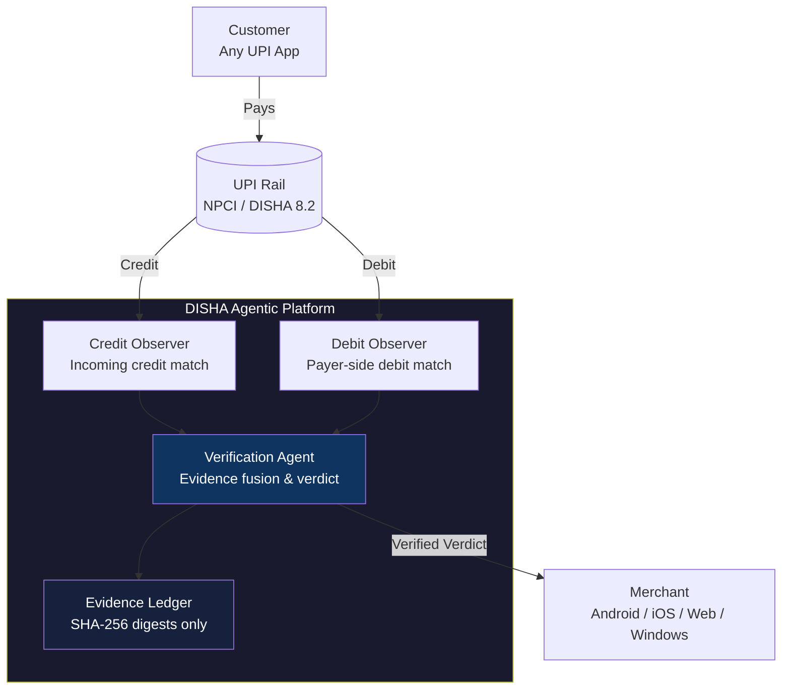
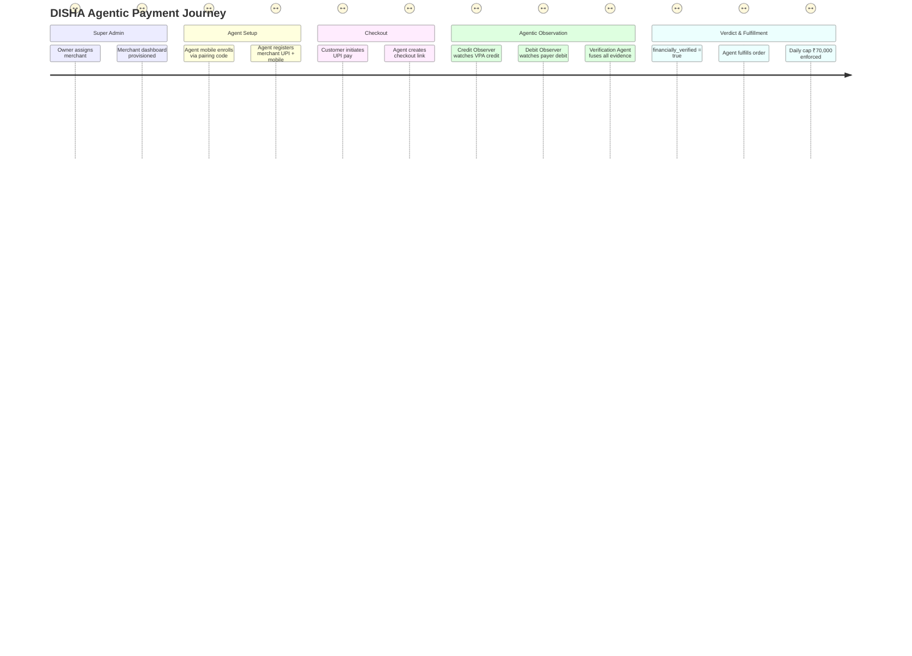

# DISHA — Agentic UPI Payment Verification Platform

**Enterprise-grade, agentic UPI debit verification. Zero PSP dependency. Zero money held. Zero fraud exposure.**

DISHA is an autonomous agent network that verifies UPI payments in real time before a merchant fulfills an order. It treats the payer device as hostile — no screenshot, UTR entry, browser resume, or synthetic local signing may set `financially_verified = true`. DISHA never holds, moves, or settles customer funds. It only observes and certifies that a debit actually completed.

Built for a 1,000-crore firm: Super Admin → Merchant → Agent → UPI hierarchy, per-merchant dashboards, audit trails, GST/tax/compliance reporting, and a ₹70,000 daily collection cap per agent mobile.

---

## Enterprise Hierarchy (Product Model)

```
Super Admin (Owner)
   │ assigns
   ▼
Merchant (firm / shop)
   │ owns
   ▼
Agent Mobile (1 per merchant device)
   │ manages up to 15 UPIs
   ▼
UPI Accounts (VPA) → Orders → Verification → Settlement
```

### Super Admin (Owner)
The platform owner. Holds the admin token (`PDEP_ADMIN_TOKEN`) and IP allowlist (`PDEP_ADMIN_IP_ALLOWLIST`). Assigns merchants, configures allowlists, and audits all activity across the platform.

### Merchant
A registered business/firm on the platform (`ap_merchants`). Each merchant:
- Owns one or more UPI accounts (`ap_accounts`)
- Has a dedicated merchant dashboard
- Is bound to agent mobile(s) via device enrollment
- Sees only their own orders, verification jobs, and audit log

### Agent Mobile
A registered Android device (`ap_devices`) bound to one merchant and one agent ID (`ap_agent_sessions`). The agent:
- Registers the merchant's UPI ID + mobile number as the receiving account
- Creates checkout links and initiates 120-second verification windows
- Collects up to **₹70,000 per day** per device, then the shop closes automatically
- Runs under `FLAG_SECURE` (screenshot prevention), root detection, and encrypted credential storage

### UPI Account (per agent, up to 15 per mobile)
Each agent mobile can manage multiple UPI accounts (designed for up to 15 concurrent VPAs). Each account is encrypted at rest (`account_cipher`, `mobile_cipher`) and bound to a specific merchant. The platform never stores raw UTRs, VPAs, balances, or PINs — only SHA-256 digests.

---

## What Is Implemented (Verified in Code)

| Component | Status | Location |
|-----------|--------|----------|
| **Super Admin authentication** | ✅ Implemented | `checkout/vpa_admin.py:require_admin` — `PDEP_ADMIN_TOKEN` + IP allowlist |
| **Merchant registry** | ✅ Implemented | `checkout/agentic_storage.py:merchants` — `ap_merchants` (id, name, token_hash, email) |
| **UPI Account registry** | ✅ Implemented | `checkout/agentic_storage.py:accounts` — `ap_accounts` (vpa, bank, holder, encrypted account/mobile) |
| **Agent device enrollment** | ✅ Implemented | `checkout/agentic_storage.py:devices` + `checkout/agentic_api.py` pairing |
| **Agent session binding** | ✅ Implemented | `checkout/agentic_storage.py:agent_sessions` — 1 agent_id per account |
| **Orders & verification jobs** | ✅ Implemented | `checkout/agentic_storage.py:orders`, `ap_verification_jobs` |
| **Audit log** | ✅ Implemented | `checkout/agentic_storage.py:audit` — `ap_audit` (merchant_id, order_id, event, detail, created) |
| **Android Receiver App** | ✅ Implemented | `recovery-agent/android/` — Kotlin, notification listener, camera OCR, audio chime |
| **UPI registration (agent → merchant)** | ✅ Implemented | `checkout/agentic_api.py:POST /api/android/register-upi` |
| **Daily ₹70,000 collection limit** | ✅ Implemented | `checkout/agentic_api.py:GET /api/android/daily-limit` |
| **Per-tab health verification** | ✅ Implemented | `checkout/saas.py:GET /api/admin/health` |
| **Android heartbeat + re-auth** | ✅ Implemented | `checkout/agentic_api.py:device_heartbeat` with `allow_offline` |

### Designed Enterprise Features (Product Roadmap)

| Feature | Design | Implementation Status |
|---------|--------|----------------------|
| Super Admin → Merchant assignment | Merchant rows exist; admin token gates writes | Merchant assignment UI pending |
| Per-merchant dashboard | `ap_merchants` + order scoping by merchant_id | Dashboard routes pending |
| 1 agent = 15 UPIs max | `ap_accounts` supports many-per-merchant; agent binding is 1:1 per session | 15-UPI cap not yet enforced in code |
| GST / tax reports | `ap_audit` + `ap_orders` provide raw data | Report endpoints pending |
| Compliance reports | Audit log captures all events | Compliance report endpoints pending |
| Bank participation licensing | Architecture supports it (no funds held) | Licensing in progress (not yet active) |

---

## Core Agents

DISHA runs four autonomous agents. Each has a single duty. Together they form an evidence chain no single channel can fake.

### Credit Observer — "Did the money arrive?"
Watches the merchant's registered VPA for incoming UPI credits. Confirms payee VPA, amount, and transaction reference match the live checkout session. Emits `CREDIT_OBSERVED` only when all three match server-side.

### Debit Observer — "Did the payer actually pay?"
Watches the payer-side confirmation flow. Validates that a debit was initiated on the payer's UPI app, correlates it to a live checkout session, and binds it to a 120-second time-bound window.

### Verification Agent — "Is the evidence complete?"
Fuses evidence from Credit Observer, Debit Observer, and the Android Receiver Agent. Applies stage-grammar sequencing, frame-anchor cryptographic binding, and anti-replay deduplication. Sets `financially_verified = true` only when the full chain is intact — never from a single channel, never from a screenshot.

### Android Receiver Agent — "The merchant's eyes and ears"
Native Android companion on the merchant device. Observes UPI notifications, camera frames (OCR), and audio success-chimes. Runs under `FLAG_SECURE`, root detection, and `EncryptedSharedPreferences` + `AndroidKeyStore`.

---

## Evidence Fusion & Zero-Fraud Model



### Why Zero Fraud

| Fraud Vector | Traditional Checkout | DISHA Agentic Platform |
|--------------|---------------------|------------------------|
| Forged screenshot | Accepted as proof | Rejected — payer device treated as hostile |
| Manual UTR entry | Error-prone, fakeable | Zero manual entry — agents observe directly |
| Single-channel spoofing | Possible | Multi-agent fusion required |
| Funds held by platform | Common | Never — DISHA touches no money |
| Replay attack | Works | Frame-anchor + SHA-256 dedup kills it |
| Agent exceeds daily limit | No cap | ₹70,000/day hard stop per device |

**`financially_verified = false` by default.** It flips to `true` only when all agents agree the debit is real, time-correlated, and amount-matched.

---

## End-to-End Flow



---

## Self-Hosted Deployment (Railway)

DISHA is production-configured for Railway. Two services run independently:

| Service | Role | Dockerfile |
|---------|------|------------|
| `checkout-api` | Public checkout + verification API | `Dockerfile` |
| `agentic-pay` | Merchant dashboard + agentic backend | `Dockerfile.agentic` |

### Deploy

```bash
railway login
railway link
railway up
```

### Required Environment Variables (Railway dashboard)

| Variable | Purpose |
|----------|---------|
| `DATABASE_URL` | Checkout PostgreSQL connection string |
| `AGENTIC_DATABASE_URL` | Agentic Pay PostgreSQL connection string |
| `AGENTIC_OWNER_TOKEN` | Super Admin secret (43–128 chars, `[A-Za-z0-9_-]`) |
| `AGENTIC_ACCOUNT_KEY` | Fernet encryption key for account/mobile data |
| `PDEP_ADMIN_IP_ALLOWLIST` | CIDR allowlist for Super Admin IP |
| `PORT` | Set automatically by Railway |

### Health Check

```bash
curl https://<service>.up.railway.app/healthz
# {"ok": true, "verification": "PENDING"}
```

---

## Project Structure

```
checkout/
├── server.py              # Public checkout + verification API
├── agentic_app.py         # Agentic Pay merchant platform entry point
├── agentic_api.py         # Agentic Pay REST API (daily limit, UPI register, email notify, heartbeat)
├── agentic_storage.py     # Isolated Agentic Pay database schema (merchants, accounts, orders, devices, audit)
├── saas.py                # Super Admin control center + per-tab health verification
├── vpa_admin.py           # VPA inventory import + admin authentication (require_admin)
├── static/                # Admin dashboard, merchant portal, checkout UI
├── agentic_assets/        # Agentic Pay frontend assets
└── Dockerfile             # Checkout API container
recovery-agent/
├── android/               # Native Android receiver app (Kotlin)
│   ├── MainActivity.kt            # Dashboard, daily ₹70,000 limit, device enrollment
│   ├── RegisterUpiActivity.kt     # UPI ID + mobile number registration
│   ├── CheckoutActivity.kt        # 120s checkout creation + auto-poll verification
│   ├── UpiPaymentObserver.kt      # Notification listener + credit observation
│   ├── HeartbeatWorker.kt         # Device heartbeat + online status
│   ├── DeviceConfig.kt            # Encrypted device config + daily limit enforcement
│   ├── RootUtil.kt                # Root detection security
│   └── ci-startup.sh              # CI emulator validation script
├── recovery/              # Recovery backend API
└── tests/                 # Integration test suites (214 passing)
.github/
└── workflows/             # CI: Checkout verification, Agentic Pay, Android APK build
railway.toml               # Railway service definitions
LICENSE                    # Proprietary Commercial License (PCL-1.0)
```

---

## Compliance & Trust

- **No money held** — DISHA never escrows, settles, or touches customer funds
- **No PSP required** — works with any UPI app, no bank integration needed
- **No sensitive data captured** — no PIN, OTP, balance, or full account numbers
- **SHA-256 digest only** — evidence ledger stores hashes, never raw UTRs or VPAs
- **120-second hard timeout** — sessions auto-expire; clock pauses during UPI app switch
- **Hostile device model** — no client-submitted proof alone sets verification
- **₹70,000 daily cap per agent mobile** — automatic shop close at limit
- **Bank participation licensing** is in progress; DISHA operates as a verification observability layer without holding funds

---

## Roadmap

| Version | Focus |
|---------|-------|
| **DISHA 8.2** (Current) | Four-agent verification, Android receiver, daily collection limit, Railway deploy, Super Admin/Merchant/Agent schema |
| **DISHA 9.0** | iOS + Windows clients, per-merchant dashboards, 15-UPI-per-agent enforcement, GST/tax/compliance reports |
| **DISHA 10.0** | Multi-merchant federation, webhook exports, bank participation licensing, PSA-level audit |

---

## License

DISHA is protected under a **Proprietary Commercial License (PCL-1.0)**.

- All rights reserved. The software is licensed, not sold.
- May not be used as a payment gateway, wallet, escrow, or any system that holds customer funds.
- Bank participation requires a separate written commercial agreement.
- Unauthorized redistribution, reverse engineering, or third-party deployment is prohibited.

See `LICENSE` for full terms.

---

## Support

- **Issues:** [github.com/Tashima-Tarsh/checkout/issues](https://github.com/Tashima-Tarsh/checkout/issues)
- **Discussions:** [github.com/Tashima-Tarsh/checkout/discussions](https://github.com/Tashima-Tarsh/checkout/discussions)
- **Security:** Report vulnerabilities privately via GitHub Security Advisories

---

*DISHA — Agentic verification that moves at the speed of UPI. Four agents. One verdict. Zero fraud. Zero money held.*
